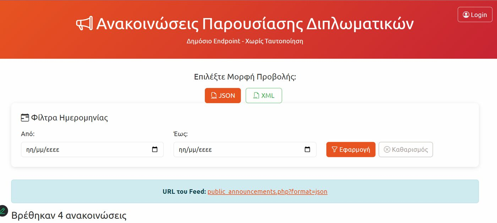
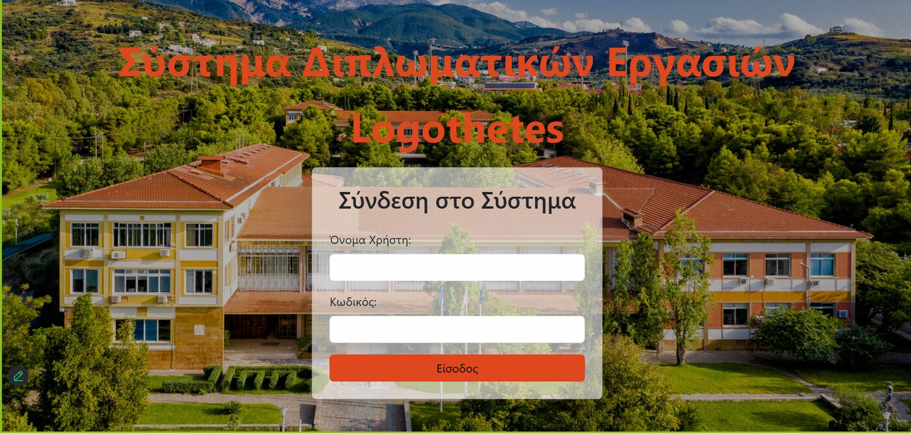
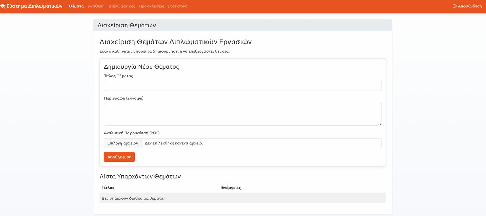
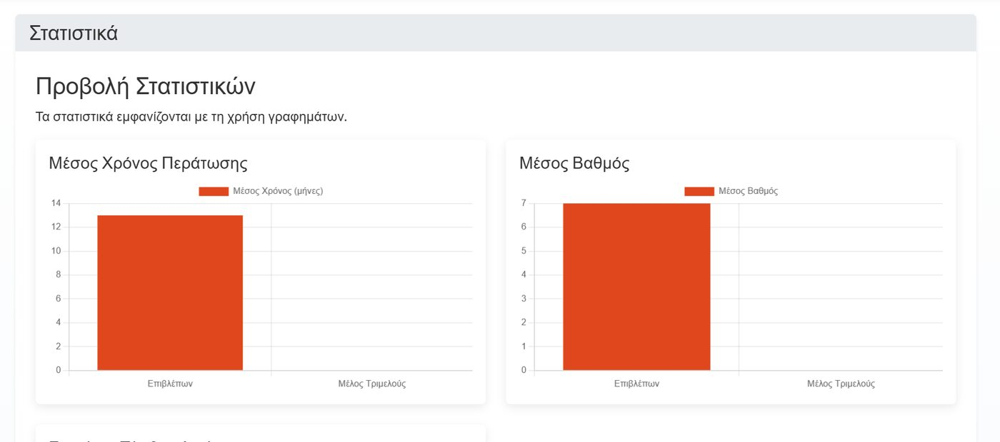
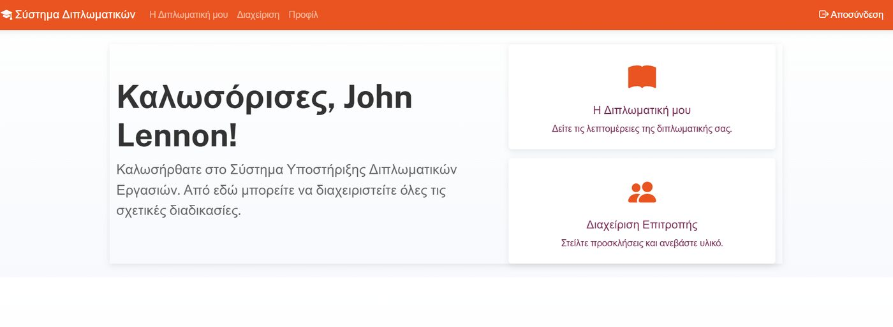
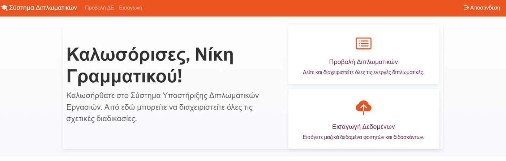

# Thesis Management System (LOGOTHETES)

A web application for managing the whole lifecycle of university diploma theses: topic creation, assignment to students, three-member committees, grading, and public presentation announcements.
Built as a team project for the course *Web Programming & Systems* (2024–2025), Department of Computer Engineering & Informatics, University of Patras. The user interface is in Greek.

## Features

**Public (no login)**
- Presentation announcements page with a date-range filter. Data is also served as **JSON or XML** (`public_announcements.php?format=json|xml`).

**All users**
- Login / logout with session handling. Every page redirects to the login page when nobody is signed in.
- Three roles with their own dashboards: **student**, **professor**, **secretary**. Passwords are stored hashed (`password_hash` / `password_verify`).

**Professor**
- Create and edit thesis topics (with an optional PDF description) and assign a topic to a student.
- View and filter the list of theses, export it as **CSV / JSON**.
- Answer invitations to join a three-member committee.
- Manage a thesis according to its status (under assignment, active, under review): private notes, grades, status changes.
- Statistics with charts (average completion time, average grade, number of theses).

**Student**
- View the assigned thesis and its details, and edit the personal profile.
- Invite professors to the committee, upload the draft text and presentation details.

**Secretary**
- View all theses and manage them (registration number, cancellation, completion).
- Import users and theses from a **JSON file**.

## Tech stack
PHP 8 (mysqli, prepared statements), MySQL / MariaDB, HTML, JavaScript (fetch API), Bootstrap, Chart-based statistics. Runs on an Apache + MySQL stack such as XAMPP.

## Screenshots

| Public announcements | Login |
|---|---|
|  |  |

| Topic management (professor) | Statistics (professor) |
|---|---|
|  |  |

| Student dashboard | Secretary dashboard |
|---|---|
|  |  |

Entity-relationship diagram: [docs/ER_diagram.png](docs/ER_diagram.png)

## Project structure
```
src/
├── login.html, login.php, logout.php, dashboard.php
├── logothetes.html, public_announcements.php   # public announcements
├── config.example.php                          # database settings template
├── frontend/{student,professor,secretary}/     # role-specific pages
├── backend/api/                                # read endpoints (JSON)
├── backend/handlers/                           # write actions (forms, uploads)
├── backend/utils/                              # helper scripts
└── assets/
database/thesis_system.sql                      # schema + demo data
docs/                                           # ER diagram, screenshots
```

## How to run (Windows, XAMPP)
1. Install [XAMPP](https://www.apachefriends.org/) and start **Apache** and **MySQL**.
2. Copy the contents of `src/` to `C:\xampp\htdocs\thesis\`.
3. Open phpMyAdmin (`http://localhost/phpmyadmin`), create a database named `thesis_system` (collation `utf8mb4_general_ci`) and **import** `database/thesis_system.sql`.
4. In `C:\xampp\htdocs\thesis\` copy `config.example.php` to `config.php` and adjust the credentials if needed (XAMPP default: user `root`, empty password).
5. Open `http://localhost/thesis/login.html` (public page: `http://localhost/thesis/logothetes.html`).

## Demo accounts
The database contains **fictional demo data only**. All demo accounts use the password `upatras123`.

| Role | Username |
|---|---|
| Professor | `demo.professor100@example.com` |
| Student | `st10434000@upnet.gr` |
| Secretary | `secretary` |

## Known limitations
- Course project / prototype: not hardened for production use (uploaded files are stored inside the web directory, error display is switched off, no CSRF protection).
- The demo password is shared by all accounts on purpose.

## Team

| Name | GitHub |
|---|---|
| Aristea Tempelopoulou | [@AristeaTemp](https://github.com/AristeaTemp) |
| Despina Papadopoulou | [@username](https://github.com/despinapap) |

Two-person team project (University of Patras, course "Programming and Systems on the World Wide Web", 2024-2025). Uploaded to GitHub after the course had ended.
